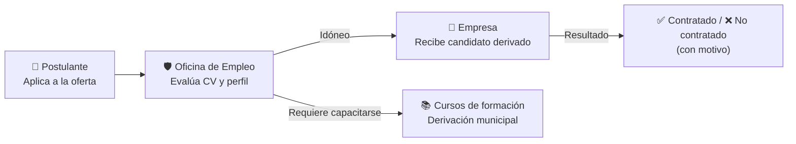

<div align="center">

# 🏛️ Portal de Empleo
### Municipalidad de Funes

Plataforma municipal de intermediación laboral diseñada para conectar a vecinos en búsqueda activa de trabajo con las empresas de la ciudad de Funes.

[](https://nextjs.org/)
[](https://react.dev/)
[](https://www.typescriptlang.org/)
[](https://tailwindcss.com/)
[](https://supabase.com/)
[](https://www.w3.org/WAI/standards-guidelines/wcag/)

</div>

---

## 💡 ¿Cómo funciona el portal?

A diferencia de los portales de empleo convencionales, este sistema implementa un modelo de **intermediación pública obligatoria**: las empresas **no acceden al padrón abierto** ni buscan perfiles directamente. La **Oficina de Empleo de Funes** actúa como nexo garantizando la privacidad de los vecinos, la idoneidad de los perfiles y la igualdad de oportunidades.



---

## 👥 Los 3 Portales

| Rol | ¿Qué hace en el portal? |
|---|---|
| **👤 Postulante** | • Explora el catálogo de ofertas activas con filtros por oficio o rubro.<br>• Crea su perfil laboral (datos de contacto, domicilio, experiencia y habilidades).<br>• Sube su CV en PDF a almacenamiento cifrado en la nube.<br>• Se postula en un clic y consulta el historial de sus postulaciones. |
| **🏢 Empresa** | • Registra su empresa (previa validación por la Oficina de Empleo).<br>• Publica ofertas de empleo con requisitos y lugar de trabajo.<br>• Consulta **únicamente** a los candidatos derivados por la Oficina de Empleo.<br>• Descarga el CV con enlaces seguros y reporta el resultado de la contratación. |
| **🛡️ Oficina de Empleo** | • Modera y aprueba empresas y ofertas laborales.<br>• Evalúa postulaciones con el CV a la vista y registra preentrevistas.<br>• Deriva los candidatos más aptos a las empresas.<br>• Busca en el padrón por oficios para asociar personas a búsquedas abiertas.<br>• Realiza seguimiento de rechazos y deriva vecinos a cursos de formación. |

---

## 🛠️ Tecnologías y Arquitectura

El proyecto está construido bajo una **arquitectura en capas estricta** (`UI → Route Handlers / Actions → Casos de Uso → DAL → Supabase`), asegurando que la lógica de negocio y las reglas de permisos estén desacopladas del almacenamiento.

```
Next.js App Router (React 19)
       │
       ▼
Casos de Uso (Reglas de negocio + Permisos por rol)
       │
       ▼
Data Access Layer (DAL con validación Zod)
       │
       ▼
Supabase (PostgreSQL + RLS + Auth + Storage privado)
```

### Stack principal

- **Frontend:** [Next.js 16](https://nextjs.org/) (App Router), [React 19](https://react.dev/), [TypeScript](https://www.typescriptlang.org/)
- **Estilos e Interfaz:** [Tailwind CSS v4](https://tailwindcss.com/), [shadcn/ui](https://ui.shadcn.com/) sobre Base UI, [Lucide Icons](https://lucide.dev/), [Motion](https://motion.dev/)
- **Base de datos y Backend:** [Supabase](https://supabase.com/)
  - **PostgreSQL** con políticas **Row Level Security (RLS)** que protegen los datos a nivel de base.
  - **Supabase Auth** con confirmación de correo.
  - **Supabase Storage** en bucket privado para los CVs (acceso mediante URLs firmadas con expiración).
- **Validación:** [Zod 4](https://zod.dev/) de extremo a extremo (cliente, API y base de datos).
- **Testing:** [Vitest](https://vitest.dev/) (unitarios) y [Playwright](https://playwright.dev/) (end-to-end).
- **Despliegue:** [Vercel](https://vercel.com/)

---

## 🎨 Diseño y Accesibilidad

- **Mosaico de oficios:** Identidad visual propia diseñada para la Municipalidad de Funes, combinando las fuentes tipográficas **Sora** y **Be Vietnam Pro**.
- **Mobile-first:** Adaptado a pantallas de teléfonos móviles desde 390px, con áreas de interacción táctil mayores a 44×44 px.
- **Accesibilidad:** Diseñado bajo estándares **WCAG 2.2 AA** (altos contrastes de lectura, navegación accesible por teclado y etiquetas claras).

---

<div align="center">

Proyecto final desarrollado en el marco del programa **Funes Tech Lab** (**Beex.dev**) para la **Municipalidad de Funes**.

</div>
